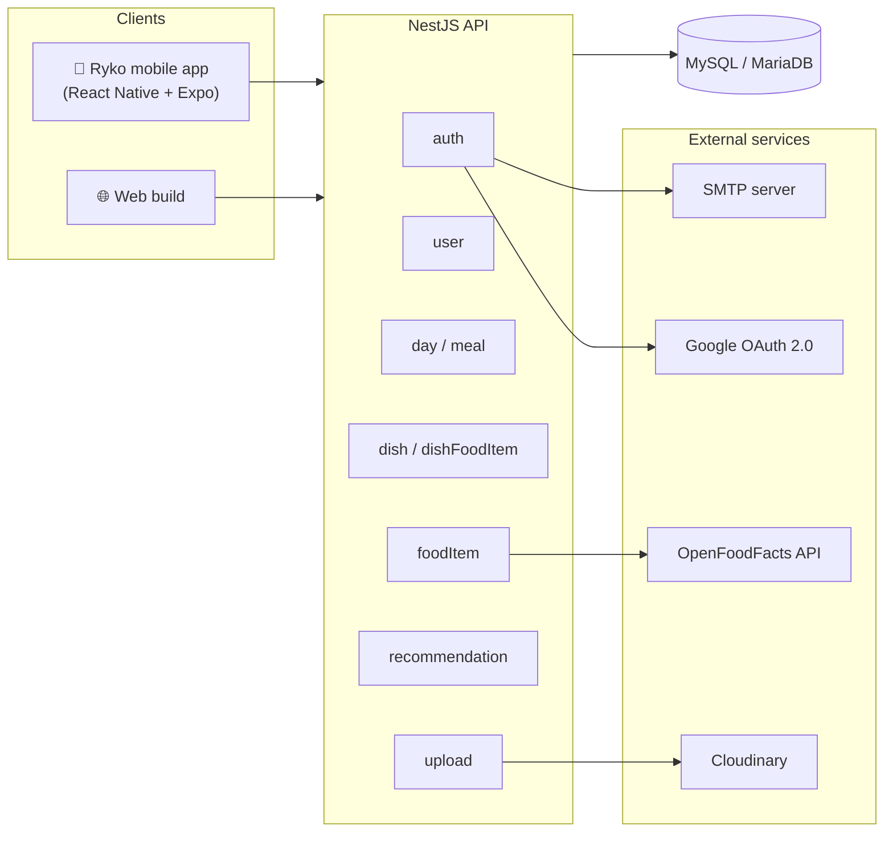
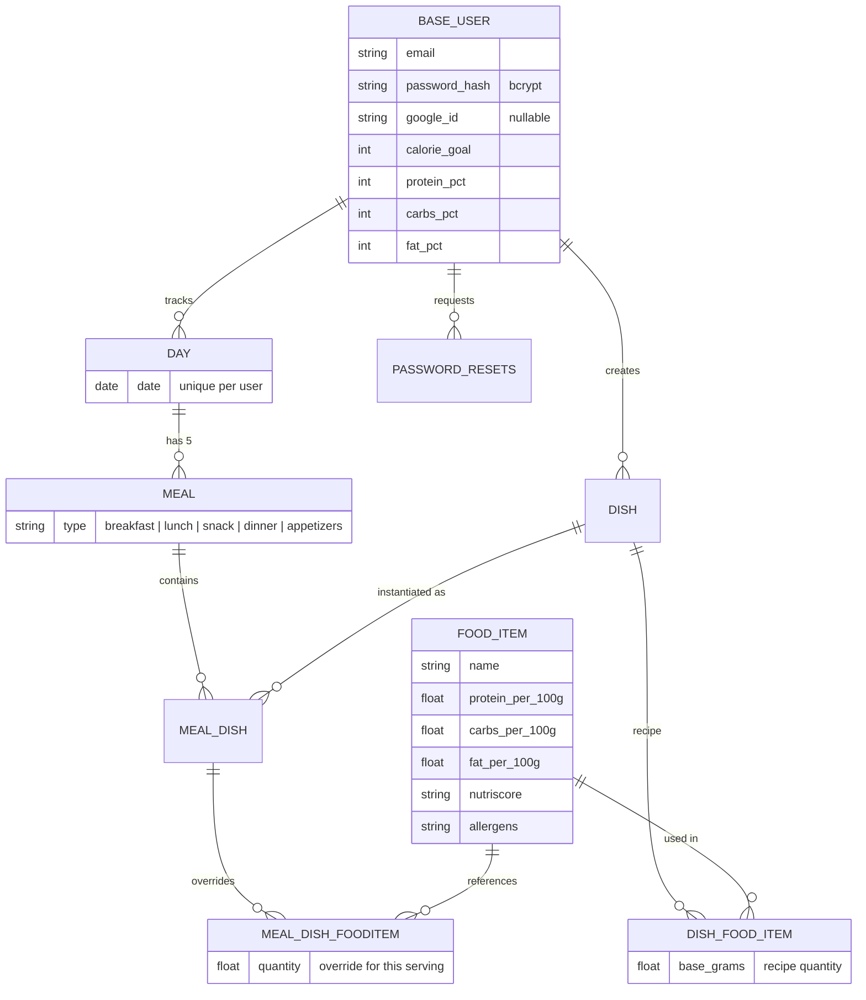
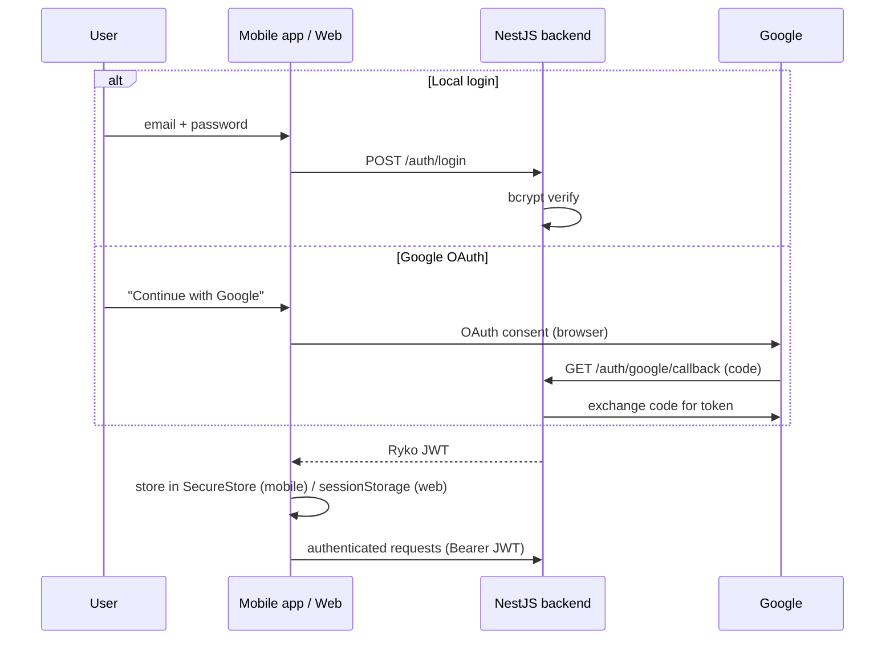

# Ryko — Backend API


REST API for **Ryko**, an intelligent nutrition assistant that tracks what you eat and recommends which of *your own* dishes — and in what portion — best fits the macros you have left for the day.

> 📱 **Mobile app:** [RykoFrontend](https://github.com/Pablorgu/RykoFrontend)

## Table of contents

- [System architecture](#system-architecture)
- [Features](#features)
- [Data model](#data-model)
- [The override system: recipes vs. what you actually ate](#the-override-system-recipes-vs-what-you-actually-ate)
- [The recommendation engine](#the-recommendation-engine)
- [Unified authentication flow](#unified-authentication-flow)
- [API overview](#api-overview)
- [Getting started](#getting-started)
- [Testing](#testing)
- [Deployment](#deployment)

## System architecture



The backend follows NestJS's native modular pattern: each domain module bundles its own controller, service, entity and DTOs, keeping domain logic cohesive and making modules independently testable. Cross-cutting concerns (validation via `class-validator` DTOs, JWT guards, configuration) are handled by the framework layer.

## Features

- **Authentication** — local accounts (bcrypt-hashed credentials) and Google OAuth 2.0 unified under a single JWT session model, plus a rate-limited, token-based password-reset flow over email
- **Daily tracking** — days are created on demand (unique per `user + date`) and always carry five meals (breakfast, lunch, snack, dinner, appetizers), enforced as a business rule
- **Custom dishes** — user-defined recipes composed of ingredients with base quantities; macros are aggregated automatically from per-100 g nutritional data
- **Food database** — ingredient search and **barcode lookup** backed by the OpenFoodFacts API, including brand, allergen and Nutri-Score metadata
- **Per-meal ingredient overrides** — adjust ingredient grams for one specific serving without touching the original recipe (see [override system](#the-override-system-recipes-vs-what-you-actually-ate))
- **Portion-aware recommendations** — a closed-form optimization picks the dish *and* portion size that best closes the day's macro gap (see [recommendation engine](#the-recommendation-engine))
- **Media uploads** — dish images stored in Cloudinary

## Data model



Key design decisions:

- **`day` is unique per `(user, date)`** — a user cannot have two entries for the same date, which keeps daily aggregation unambiguous.
- **Meals are rows, not columns** — the five daily meals live in a `meal` table with a `type` attribute instead of five fixed columns on `day`, so new meal categories can be added without a schema redesign.
- **`meal_dish` allows repetition** — the same dish can be added to the same meal more than once (two servings of rice = two independent records), mirroring real eating habits.
- **Nutritional data is centralized** in `food_item` (per 100 g, sourced from OpenFoodFacts), so recipes never duplicate nutrient values and consistency is guaranteed.
- Schema changes are versioned through **TypeORM migrations**.

## The override system: recipes vs. what you actually ate

A common failure mode of nutrition trackers is forcing users to create endless variants of the same dish ("chicken with rice, but with a bit more chicken today"). Ryko solves this with a **clone-on-add override pattern**:

1. When a dish is added to a meal, a `meal_dish` record is created, and each recipe ingredient in `dish_food_item` is **cloned** into `meal_dish_fooditem` with its default grams.
2. From that point on, each ingredient of *that specific serving* can be adjusted independently (the mobile app uses sliders). Changes are written only to the clone — the original recipe stays intact.
3. Macros are recalculated automatically at dish, meal and day level from the overridden quantities.

This keeps a clean separation between the user's **recipe library** (stable, reusable) and their **consumption log** (flexible, day-by-day), while the database stays small: only ingredients, grams and dishes are persisted — aggregate values are computed, never stored.

## The recommendation engine

The recommender answers a concrete question: *"Of all the dishes I actually cook, which one — and how much of it — should I eat next to hit today's macros?"* Recommending only from the user's own dishes is a deliberate choice to maximize adherence, rather than suggesting generic recipes nobody will cook.

It is a **closed-form weighted least-squares optimization** — transparent and O(n) in the number of dishes, with no black box:

1. **Remaining macros.** The target vector $R = (R_p, R_c, R_f)$ is the difference between the user's daily goals and what they have already eaten.
2. **Dish vector.** Each candidate dish contributes $P = (P_p, P_c, P_f)$, the macros of its base serving, aggregated from its recipe ingredients.
3. **Energy weighting.** Errors are weighted by energy density — $w = (4, 4, 9)$ kcal/g for protein, carbs and fat — so a 10 g miss in fat costs more than a 10 g miss in carbs, exactly as it does calorically.
4. **Optimal portion scale.** For each dish, the portion multiplier that minimizes the weighted squared error has a closed-form solution:

$$s^* = \frac{\langle P, R \rangle_w}{\langle P, P \rangle_w} \qquad E(s) = \sum_{i \in \{p,c,f\}} w_i \,(s P_i - R_i)^2$$

   $s^*$ is clamped to a practical range (0.1–5 servings) and proposals scaling below 5 g of protein are discarded as irrelevant.

5. **Diversity penalty.** To avoid recommending the same dish every day, the score is inflated by 20% per consumption in the last 7 days: $score' = score \cdot (1 + 0.2n)$. A dish eaten twice this week needs to be meaningfully better than a fresh alternative to win.
6. **Filters and diagnostics.** Rejected suggestions can be excluded (`?exclude=[ids]`) so "give me another one" never repeats itself; edge cases (no dishes, no goals, goals already met, all candidates excluded) return structured `diagnostics` the client turns into guidance.

The response includes the chosen dish, the scale factor, per-ingredient gram overrides (rounded to servable amounts) and the resulting macros — ready to be accepted into a meal with a single request.

> An ingredient-by-ingredient optimization was evaluated and deliberately rejected: it produces mathematically better but culinarily absurd results (salads that are mostly olive oil). Scaling the dish as a block preserves ingredient proportions and stays understandable — "have one and a half servings" beats an arbitrary gram combination.

## Unified authentication flow

Local login and Google OAuth converge on the same session model — the client always ends up holding a Ryko-signed JWT, regardless of provider:



Design notes:

- The **backend-side callback** absorbs the web-vs-mobile redirect asymmetry (HTTPS callback URLs vs. `ryko://` deep links), eliminating `redirect_uri` mismatches — the frontend receives the same kind of token either way, and Google credentials never reach the client.
- Passwords are hashed with **bcrypt** (salted); Google-only accounts store no password at all.
- Password recovery uses **single-use, expiring tokens** (`password_resets` table) with attempt limiting, sent over SMTP.

## API overview

All routes below `auth/*` require a Bearer JWT. Main resource groups:

| Resource | Highlights |
| --- | --- |
| `POST /auth/register` · `POST /auth/login` · `GET /auth/google` · `GET /auth/me` | Local + OAuth authentication, session introspection |
| `POST /auth/forgot-password` · `POST /auth/reset-password` | Token-based password recovery |
| `GET /day/:date` · `POST /day/:date/meals/:type/dishes` | Day access (auto-created on first visit), adding dishes to meals — including `/with-scale` for accepting recommendations |
| `PATCH /day/:date/meals/:type/dishes/:mealDishId/ingredients/:ingredientId` | Per-serving ingredient override (the sliders endpoint) |
| `GET /dishes/filter` · `POST /dishes` · `PUT /dishes/:id/ingredients` | Recipe library CRUD with filtered and summary views |
| `GET /fooditems` · `GET /fooditems/:barcode` | Ingredient search and barcode lookup via OpenFoodFacts |
| `GET /recommendation/:date` | Portion-aware dish recommendation (supports `exclude`) |
| `GET /users/...` · `/admins/...` | Profile, nutrition goals, role-based admin access |
| `POST /upload/image` | Dish images to Cloudinary |

## Getting started

**Requirements:** Node.js ≥ 16, MySQL/MariaDB ≥ 10, npm ≥ 8

```bash
git clone https://github.com/Pablorgu/RykoBackend.git
cd RykoBackend
npm install
```

Create a `.env` file in the project root:

| Variable | Purpose |
| --- | --- |
| `DATABASE_HOST` / `DATABASE_PORT` / `DATABASE_USER` / `DATABASE_PASSWORD` / `DATABASE_NAME` | Database connection |
| `JWT_SECRET` | Token signing |
| `GOOGLE_CLIENT_ID` / `GOOGLE_CLIENT_SECRET` | Google OAuth |
| `SMTP_HOST` / `SMTP_PORT` / `SMTP_USER` / `SMTP_PASS` | Password-recovery emails |
| `CLOUDINARY_CLOUD_NAME` / `CLOUDINARY_API_KEY` / `CLOUDINARY_API_SECRET` | Image storage |

Run it:

```bash
npm run start:dev   # development (watch mode)
npm run start:prod  # production build
```

## Testing

```bash
npm test            # unit tests (Jest)
npm run test:e2e    # end-to-end tests
npm run test:cov    # coverage report
```

Code quality is enforced with **ESLint + Prettier**; commits follow the Conventional Commits style (`feat(meal): ...`, `fix(auth): ...`).

## Deployment

The system was deployed to production during the project, with the full stack running in the cloud:

| Component | Service |
| --- | --- |
| Backend API | Render |
| Web frontend | Render (static web build) |
| Database | Aiven-managed MySQL over TLS |
| OAuth | Google Cloud Console credentials |
| Domain | Custom domain routed to Render |

## Author

**Pablo Ruiz Galianez** — [GitHub](https://github.com/Pablorgu) · [LinkedIn](https://www.linkedin.com/in/pablo-galianez/)

Developed as my BSc thesis in Software Engineering at the University of Málaga — the full thesis covers requirements analysis, UML design, implementation and evaluation.
